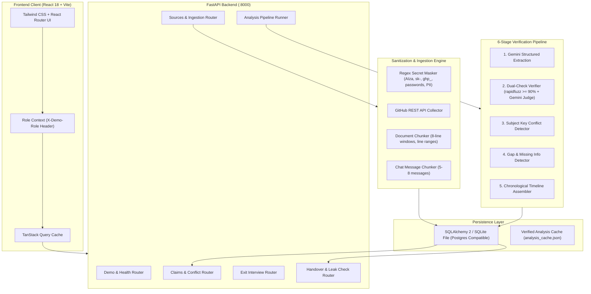
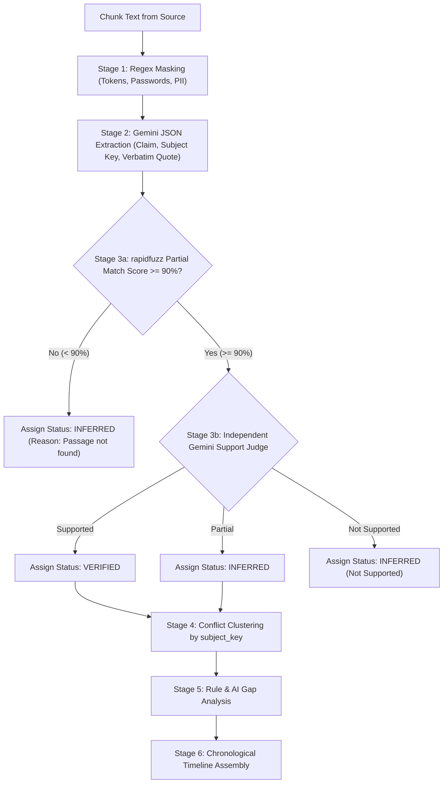

# HandoverLedger System Architecture

HandoverLedger reconstructs project state into an atomic, verifiable knowledge ledger when a team member departs. It guarantees that every statement links to a verifiable source passage, enforces strict multi-level clearance isolation at the database query layer, identifies documentation gaps, and compiles role-tailored handover documentation.

---

## 1. High-Level System Architecture

---

## 2. The 6-Stage Pipeline & Dual-Check Verification

Every factual claim in HandoverLedger undergoes an independent two-stage verification process:

### Trust Rules & Verifier Mapping

- **VERIFIED**: Quote fuzzy match score $\ge 90.0\%$ inside source chunk AND independent check evaluates as `"supported"`.
- **INFERRED**: Quote fuzzy match score $\ge 90.0\%$ but independent check evaluates as `"partial"`.
- **NEVER VERIFIED**: If quote is not found in source text ($< 90.0\%$), it is flagged as `"no valid passage found"` and cannot be marked verified regardless of LLM assertions.
- **LEAVER-ATTESTED**: Information provided by the departing member during the exit interview is recorded as `created_by = "leaver"`. It is classified honestly as `"inferred"` with a purple badge and cannot be marked as verified.

---

## 3. Clearance Model & Security Isolation

Clearance filtering is enforced **strictly at the database query layer** (`backend/models.py:query_claims_with_clearance`) rather than route handler logic:

$$\text{Clearance}_{\text{Claim}} = \max_{e \in \text{Evidence}} (\text{Clearance}_{\text{Source}}(e))$$

| Clearance Level | Description | Cleared Roles |
| :--- | :--- | :--- |
| **Level 1: General** | Public repository info, club meeting decisions, non-sensitive issues. | Coordinator, Developer, Departing Member, Lead |
| **Level 2: Technical** | Docker configurations, deployment architecture, runtime risks, memory limits. | Developer, Departing Member, Lead |
| **Level 3: Confidential** | Master root credentials, disaster recovery passwords, administrative signoff keys. | Project Lead Only |

### Security Leak Check

Before any handover release or export, the system executes an automated security audit (`POST /api/handover/leak-check`):
1. **Clearance Barrier Audit**: Asserts that no claim with clearance higher than the target role exists in the rendered view.
2. **Secret Pattern Scan**: Scans all rendered prose and citations for leaked API keys (`AIza...`, `ghp_...`, `sk-...`), raw `password=...` strings, unmasked emails, or phone numbers.
3. If any finding is detected, Markdown and PDF exports are **strictly blocked (HTTP 400)**.

---

## 4. Key Technical Decisions & Libraries

- **Backend**:
  - **FastAPI**: Asynchronous high-performance REST API with automated OpenAPI 3.1 documentation.
  - **SQLAlchemy 2**: Modern declarative ORM with parameterized query building. Enables seamless migration from local SQLite to Supabase PostgreSQL without code changes.
  - **rapidfuzz**: C++ accelerated fuzzy string matching (`partial_ratio`) for fast passage verification.
  - **google-genai**: Official Google Gemini SDK supporting structured JSON generation with exponential backoff on 429 quota exhaustion.
  - **pypdf**: Robust local PDF text extraction without external system dependencies.

- **Frontend**:
  - **React 18 + Vite**: Fast build and HMR development environment with strict TypeScript typing.
  - **Tailwind CSS**: Strict custom design system adhering to the specified color palette (#1F3864 navy, #0F766E teal, #F8FAFC page background, 12px radius cards).
  - **TanStack Query**: Server state caching, role-switching invalidations, and background polling.
  - **Lucide Icons**: Semantic iconography for all claim types, statuses, and navigation items.

---

## 5. AI Assistance Disclosure

HandoverLedger was architected and built with AI assistance utilizing **Google Antigravity** and **Gemini 2.5 / 1.5 Flash**. The underlying verification engine adheres to strict zero-hallucination trust rules, requiring algorithmic proof for every verified claim.

